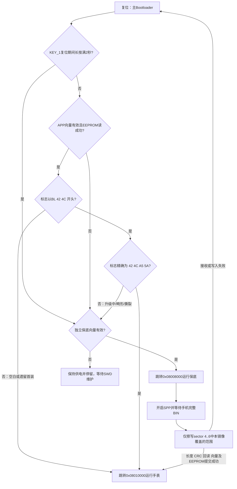

# F411 主引导、独立保底与手机蓝牙 OTA

2026-11-02启用三个独立程序：主Bootloader读取EEPROM和按键后选择跳转目标；保底程序独立驻留，负责KT6368A、SPP接收、CRC和Flash更新；手表APP运行FreeRTOS/LVGL及传感器业务。沿用F407的分层职责，F411直接写内部Flash。

## 当前分区与工程

| 程序 | Keil工程 / Target | Flash范围（含末地址） | 容量 / 扇区 |
| --- | --- | --- | --- |
| 主Bootloader | `MDK-ARM/f411_bootloader.uvprojx` / `f411_bootloader` | `0x08000000..0x08007FFF` | 32KiB / sector 0..1 |
| 独立保底程序 | `MDK-ARM/f411_recovery.uvprojx` / `f411_recovery` | `0x08008000..0x0800FFFF` | 32KiB / sector 2..3 |
| 升级手表APP | `MDK-ARM/f411ceu6_upgrade_app.uvprojx` / `f411ceu6_upgrade_app` | `0x08010000..0x0805FFFF` | 320KiB / sector 4..6 |
| 电压与复位日志 | APP管理 | `0x08060000..0x0807FFFF` | 128KiB / sector 7 |
| 独立普通APP | `MDK-ARM/f411ceu6.uvprojx` / `f411ceu6` | `0x08000000..0x0805FFFF` | 384KiB，单独使用 |

普通APP占用主引导和保底所在区域，不能与三程序部署同时使用。手机OTA只能发送升级APP的原始BIN，最大327680字节。旧版`0x08008000`链接的APP及352KiB容量配置已停用，不能继续发送到本版设备。

布局定义为`common/boot_layout.h`。Keil链接配置和手机端也使用上表边界，由回归检查一致性。升级APP的向量偏移为`0x10000`，保底程序的向量偏移为`0x8000`，两个APP继续使用原`*_flash_safe.sct`内的SRAM日志编程段。

## 启动与保底



主引导入口为`bootloader/boot_main.c`，选择逻辑为`application/app_boot_select.c`，不链接蓝牙驱动或固件擦写模块。正常启动只读EEPROM，不写标志，也不会引入无条件开机延时。复位后PA5（KEY_1，空闲高、按下低）若为高立即进入正常判定；只有检测到按下才每10ms轮询，复位期间连续按住满2秒进入独立保底，任何提前松开都视为正常启动。APP向量有效且EEPROM读取成功时，若标志不以`42 4C`（BL）开头（空白或首次SWD下载APP的遗留记录）直接启动APP；若以BL开头则只有精确`42 4C A5 5A`才启动APP，`42 4C 5A A5`升级中、畸形或撕裂标志均进入独立保底。APP向量无效或EEPROM读取失败同样进入独立保底。

保底入口为`bootloader/recovery_main.c`，复用`application/app_bootloader.c`、`interface/int_bootloader.c`。INIT → RUN → REC_DATA → CHECK_DATA → JUMP_TO_APP状态机在保底区运行，升级失败会复位回主引导，再由主引导重新进入保底。保底没有安装或向量损坏时，主引导不会跳转未知代码，该情况需通过SWD恢复保底。

两者共用`bootloader/boot_platform.c`，最先拉高PA3保持电源，使用HSI PLL 100MHz，并在跳转时关闭SysTick、清NVIC、设置目标VTOR/MSP。交接不调用会复位GPIO的`HAL_DeInit()`。保底内的UART/DMA由保底自己停止。

## EEPROM与APP进入升级

板上BL24C02F使用PA12=SCL、PA11=SDA、7位地址`0x50`。`0xC0..0xC3`保存四字节状态：

| 内容 | 含义 |
| --- | --- |
| `42 4C 5A A5` | 升级中，主引导进入独立保底 |
| `42 4C A5 5A` | APP有效，仍须通过APP向量检查 |
| 不以`42 4C`开头（空白或首装遗留） | 主引导在APP向量有效时直接启动APP，允许SWD首装后免手机升级启动 |
| 以`42 4C`开头但非上述精确值（畸形/撕裂） | 进入独立保底 |
| EEPROM读取失败或APP向量无效 | 进入独立保底 |

校准`0x00..0x9F`、运行时间`0xA0..0xBF`、新天气记录`0xD0..0xEF`维持现有布局。旧`0xC0`天气记录只读兼容，不再写入。

升级APP从唯一BLE业务入口接收`OTA,START`加实际LF/CRLF。sensor任务等其他EEPROM保存结束后写入并读回升级中标志，LVGL回传`OTA,REBOOTING,SPP`，UART完成后留500ms发送窗口再软件复位。蓝牙断开不撤销已接受的完整请求；回执未完成时最多等2秒后仍复位。EEPROM失败返回`OTA,EEPROM_ERROR`，不执行软件复位。普通独立APP返回`OTA,UNAVAILABLE,INSTALL_BOOTLOADER_AND_UPGRADE_APP`。

保底在合法start命令后，先持久化升级中标志，成功才擦除APP；完整镜像、CRC和向量提交成功后，再写入并读回APP有效标志。升级中断后重新发送完整镜像，不续传、不回滚。首次通过SWD部署主引导、保底和APP后，EEPROM空白或遗留非BL记录即可直接启动有效APP，无需先完成一次手机升级；手机升级只用于后续更新及在EEPROM建立标准有效标志。

## 手机操作与首次部署

新版APK为`E:\Downloads\Bluetooth-Wave-OTA.apk`，版本`1.95-wave.16-recovery` / code21。基于用户提供的`base.apk`扩充旧波形App，保留波形、诊断、收发和导出入口。原签名密钥未提供，扩充版包名为`xnj.lazydog.btcontroller.wave.ota`，与原波形版并存；与上一版OTA扩充版使用同一签名，可覆盖上一版OTA扩充版。原App设置不会自动迁移。

1. 首次通过SWD部署`F411-OTA-Bootloader.hex`和`F411-OTA-Recovery.hex`；也可使用包含这两个程序的`F411-OTA-Factory.hex`一次下载。**必须部署主引导与独立保底两部分**，只更新主引导不足以启用本结构。若同时SWD下载链接到`0x08010000`的升级APP，EEPROM空白或遗留非BL记录时主引导可直接启动该APP，不必先做一次手机升级。
2. 下载选择覆盖扇区擦除，避免整片擦除日志。要进入保底：在复位期间持续按住KEY_1（PA5）满2秒，保持按住直到保底启动，过早松开将正常启动APP。手机OTA页的`OTA,START`同样显式进入保底。
3. 安装本版APK并允许附近设备权限，将本版`F411-OTA-Upgrade-App.bin`复制到手机。在原主界面打开“手表固件升级 · OTA”，选择BIN，页面会核对320KiB上限、MSP/Reset并计算CRC。
4. 在安卓系统蓝牙设置中配对手表模块的经典蓝牙SPP设备；SPP名称沿用模块原设置，不一定与`F411-Watch`的BLE名称相同。回到OTA页，选择对应已配对设备并确认发送。
5. 手机先查询设备布局，确认APP起点`0x08010000`和容量`0x50000`后才发送start。等待ready后，以每256字节间隔40ms发送BIN。进度100%仍需等待设备回执；只有收到匹配长度的`ok,len:N`才显示升级成功。
6. 手表启动后关闭SPP，回原主界面重新连接BLE（FFF0服务、FFF1收发，订阅Notify）。后续可以通过页面“让手表进入升级模式”发送BLE命令进入独立保底，也保留KEY_1入口。

进入升级按钮只报告命令已提交，不冒充设备确认。若没有重启，查看原接收窗口中的OTA错误，或使用按键。首次只有主引导和保底时直接使用按键入口。

传输期间保持页面前台、手机蓝牙及手表供电；停止、切后台、断连或阶段超时会关闭本次SPP连接，不自动重试。未完成接收时保底在30秒无进展后复位，再次进入保底等待完整重传。

## 字节流协议与擦写范围

1. 手机发送`OTA,INFO\n`，保底返回`OTA,LAYOUT,08010000,00050000`。本版手机拒绝旧布局或不识别查询的设备，不发送start。
2. 手机发送`start:十进制长度:8位CRC32\n`。CRC为CRC-32/ISO-HDLC，与Python `zlib.crc32(BIN)`一致。保底继续兼容原`start:长度`调试方式，无CRC模式会警告，畸形CRC字段不会降级。
3. 等待`Flash erased, ready to receive data...`后发送原始BIN。不能添加HEX文本、换行、包头或包尾；接收阶段的新start会被当成正文。
4. 完整接收并处理后留100ms保护窗口，检查多收字节、CRC、回读和向量；确认后回传`ok,len:N`，留500ms发送窗口再跳APP。错误回传后复位。

| APP长度 | 擦除扇区 | 覆盖范围 |
| --- | --- | --- |
| 8..65536字节 | sector 4 | `0x08010000..0x0801FFFF` |
| 65537..196608字节 | sector 4..5 | `0x08010000..0x0803FFFF` |
| 196609..327680字节 | sector 4..6 | `0x08010000..0x0805FFFF` |

最后镜像地址使用`APP_START_ADDR + length - 1`，边界长度不会多擦一个扇区。只在接收前擦除一次；短镜像范围以外的旧APP尾部可以保留。主引导、独立保底及日志均不在OTA可擦写范围内。

DMA2 Stream5/Channel4使用8192字节循环缓冲和HT/TC标记，主循环复制到512字节工作缓冲后按半字写内部Flash。首8字节向量暂存，长度、CRC、回读和向量通过后才提交，MSP最后写；奇数末字节补FF，不计入BIN长度或CRC。UART/DMA错误、缓冲覆盖或Flash失败会终止本轮。

保底不运行FreeRTOS、LVGL和传感器任务，屏蔽TPS3823的RST，不启用内部IWDG；接收超时由状态机处理，执行停滞没有看门狗复位。CRC仅用于检错，没有镜像签名或A/B回滚。

## 构建与验证

使用Keil ARMCC 5.06，分别构建主引导、保底和升级APP三个工程，普通APP仍可单独构建。输出目录分别为`MDK-ARM/bootloader/`、`MDK-ARM/recovery/`、`MDK-ARM/f411ceu6_upgrade_app/`。手机源码及APK重建脚本见[android-ota](../tools/android-ota/README.md)。

```powershell
python -X utf8 tests/bootloader/run.py
python -X utf8 tests/ota/run.py
python -X utf8 tests/battery_log/run.py
```

主机执行真实选择逻辑、保底状态机、蓝牙驱动、EEPROM及Flash接口，覆盖空白/遗留首装直接启动APP、精确有效标志、升级中/畸形/撕裂BL标志、EEPROM读取失败、无效APP向量、缺失或错误保底向量的跳转。新增`tests/bootloader/boot_entry_harness.c`包含真实`boot_main.c`的`boot_recovery_requested`辅助函数，用自定义`entry_host/main.h`最小HAL桩验证空闲高电平立即返回、提前松开、1990ms松开、连续按住满2000ms及uint32 tick回绕判定。完整320KiB镜像、奇偶长度、DMA回绕、CRC损坏、写后读回和掉电标志路径保持不变，模拟擦写模型拒绝sector 0..3及7，完整镜像后确认主引导、保底和日志内容保留。手机与Python发送测试检查新分区、查询在start之前、ready在正文之前，以及旧布局在擦除前被拒绝。

构建、主机和模拟器证据不代替实板验证。本次没有烧录手表；首次部署、实际SPP连续接收、Flash时序、断电后的重传与跳转仍需实机确认。

本版四个Keil目标均链接成功：主引导、保底、普通APP为0错误/0警告；升级APP因链接偏移变化全量重编，包含13条既有LVGL警告，新增引导/保底代码无警告。MAP的ROM占用分别为主引导6008字节、保底18492字节、升级APP223660字节，均在各自分区内。导出的三个HEX已核对地址、MSP与Reset范围，APP BIN与HEX逐字节一致，合并的Factory HEX只包含主引导和保底，地址低于`0x08010000`。
